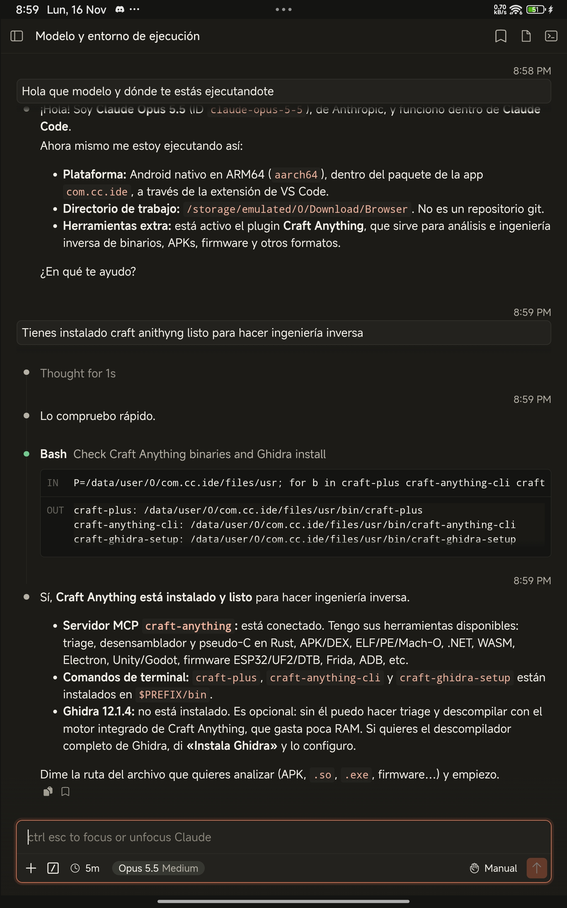
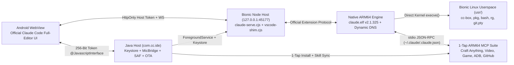
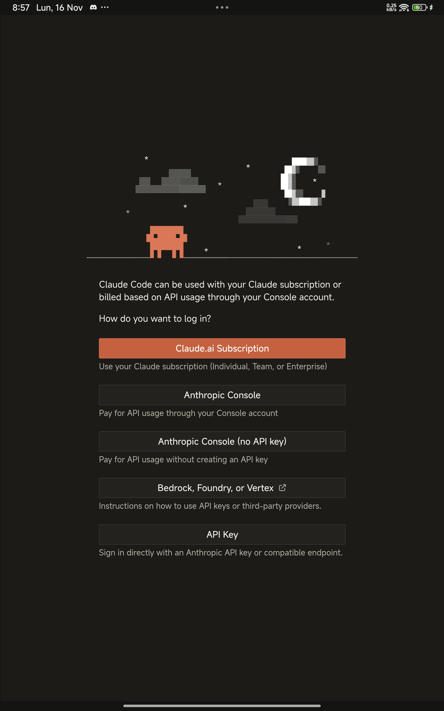
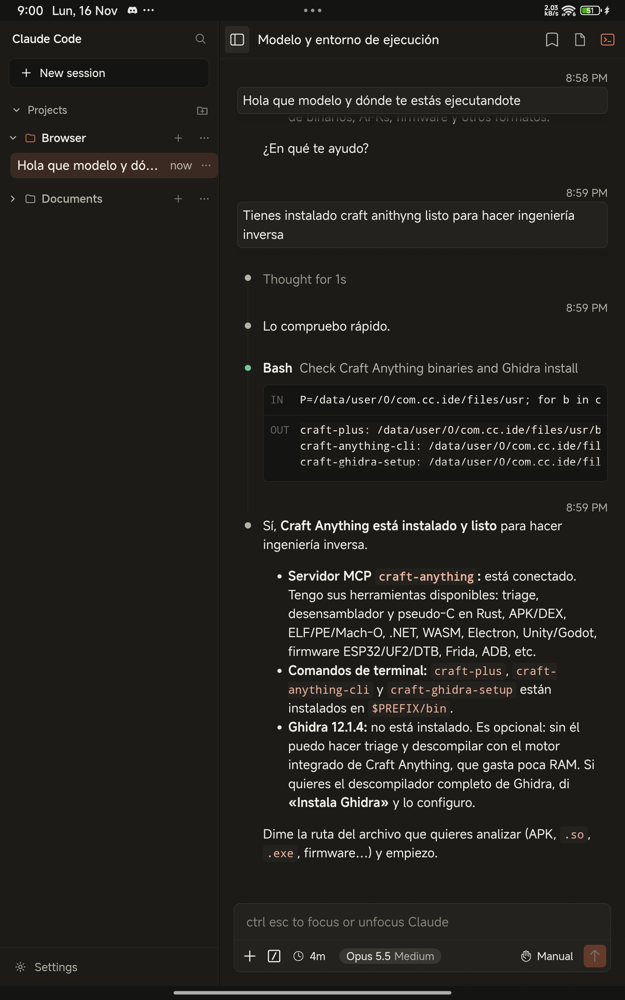
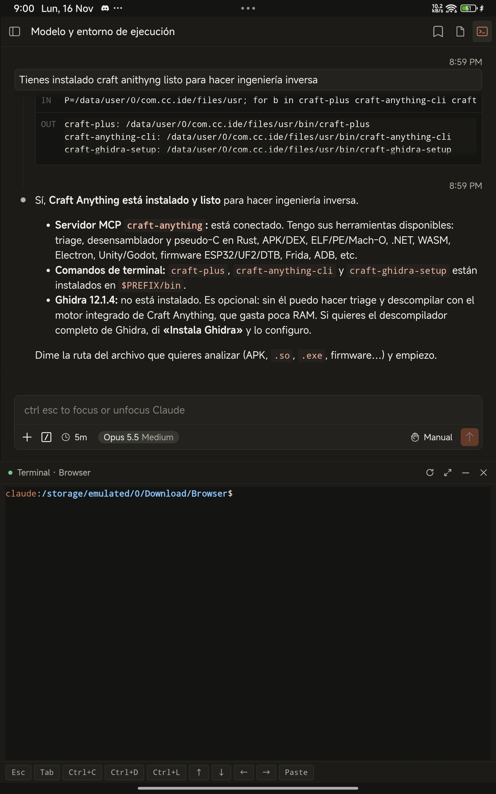
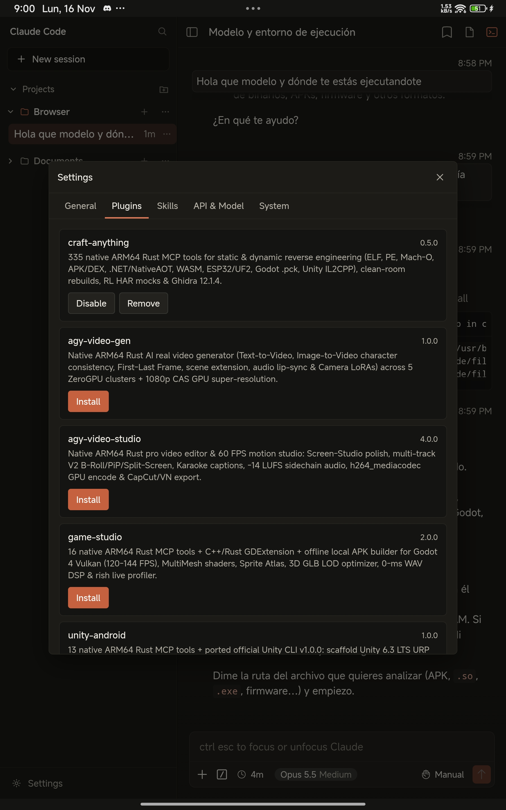
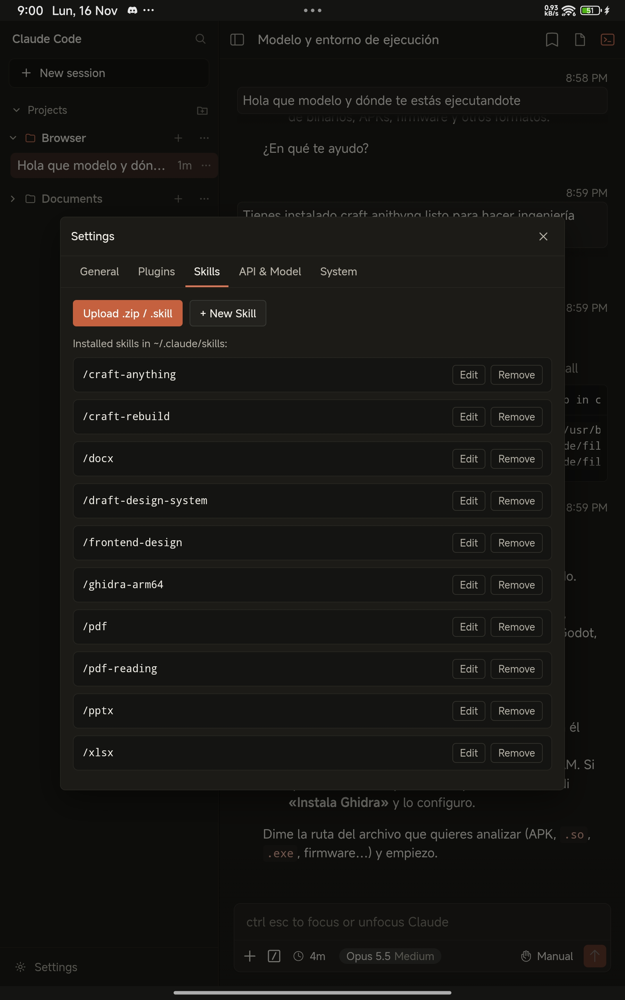
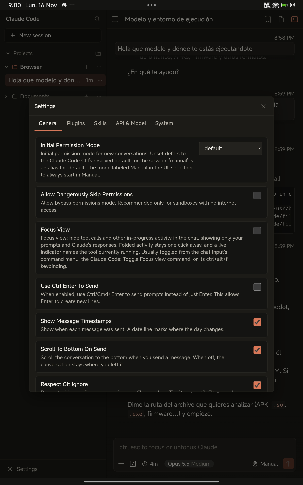

<div align="center">

  <br/>

  

  <h1 align="center">Claude Code for Android</h1>

  <p><font color="#7d8590">Standalone <b>Anthropic Claude Code (<code>v2.1.325</code>)</b> Full-Editor agentic IDE &amp; native <b>ARM64 Android</b> APK — created and engineered by <a href="https://github.com/Yhoanes"><b>Yhoanes</b></a> (zero PRoot, zero Electron, zero Termux dependency, zero Gradle).</font></p>

  <p>
    <code>v2.1.325-r1</code> &nbsp;&bull;&nbsp;
    <code>Android 9.0+ (API 28+)</code> &nbsp;&bull;&nbsp;
    <code>Official Full-Editor UI</code> &nbsp;&bull;&nbsp;
    <code>Direct Kernel execve() ARM64</code> &nbsp;&bull;&nbsp;
    <code>Keystore AES-256-GCM</code> &nbsp;&bull;&nbsp;
    <code>1-Tap ARM64 MCP Plugins &amp; Skills</code> &nbsp;&bull;&nbsp;
    <code>Live GitHub OTA</code>
  </p>

  <br/>

  

</div>

<br/>

---

## Architectural Overview

**Claude Code for Android (`v2.1.325-r1`)** brings Anthropic's official **Claude Code Full-Editor UI** (`anthropic.claude-code` `v2.1.325`) and native ARM64 **`claude` CLI engine** directly to Android phones and tablets as a self-contained standalone APK (`com.cc.ide`).

Unlike slow `proot-distro` containers, emulated Linux VMs, or remote SSH wrappers, **Claude Code for Android** executes natively on mobile ARM64 silicon via direct Linux kernel `execve()`: pairing an isolated ARM64 `claude.elf` + LSE-compatible runtime with a Bionic `Node.js` VS Code Extension Host (`claude-serve.cjs` + `vscode-shim.cjs`), a 10-byte prefix-aligned **Android Bionic Linux userspace** (`/data/user/0/com.cc.ide/files/usr`) powered by **`cc-box`**, hardware-backed **Android Keystore (`AES-256-GCM`)** credential encryption, and a **1-Tap Native ARM64 MCP Plugins &amp; Skills Marketplace**.

> [!IMPORTANT]
> **10-Byte Native Prefix Parity (`com.cc.ide` == `com.termux`):** By engineering an exact 10-character Android application ID (`com.cc.ide` for release, `com.cc.dev` for side-by-side dev builds), the embedded Linux userspace maintains binary path-length parity with standard Bionic packages — enabling direct native execution of `clang`, `rust`, `python`, `nodejs`, `git`, `ripgrep`, `ghidra`, and `openjdk-21` at physical UFS storage speeds with **zero `PRoot` overhead**.



---

## Core Engineering Pillars

| Subsystem | Technical Implementation |
| :--- | :--- |
| **100% Authentic Claude Code Full-Editor UI** | Runs Anthropic's unmodified `v2.1.325` `extension.js` and Full-Editor webview (`IS_FULL_EDITOR = true`) with warm Claude Dark (`#141413` / `#D97757`) &amp; Light (`#FAF9F5`) theming, thinking blocks, interactive tool permissions, plan/auto modes, rich file diffs, session file tracking, bookmarks, and slash commands. |
| **Official OAuth + Keystore-Encrypted API Keys** | Sign in seamlessly with your **Claude.ai Subscription** (Pro / Max / Team / Enterprise via Chrome Custom Tabs OAuth), **Anthropic Console**, or any compatible `ANTHROPIC_API_KEY` / `ANTHROPIC_BASE_URL` encrypted at rest with **`AndroidKeyStore` AES-256-GCM** (`SecretStore` — never written in plaintext to disk). |
| **Capability-Hardened Local Security** | Non-exported internal activities, per-boot 256-bit loopback `CC_HOST_TOKEN` (`HttpOnly; SameSite=Strict` cookie + `Host`/`Origin` DNS-rebinding &amp; CSRF verification), randomized WebView native bridge bindings, and strict path confinement protecting credentials and WebView databases. |
| **Multi-Project Sidebar &amp; Docked PTY Terminal** | Clean responsive workspace sidebar (`Projects` via Android SAF folder picker, per-folder sessions, rename/delete, instant session switching), active session modified-files viewer, and a persistent per-project docked **`xterm.js` PTY terminal** (`opencode-pty` + Bionic `bash`) with mobile modifier keys (`Esc`, `Tab`, `Ctrl+C`, arrows, `Paste`). |
| **On-Demand Native Voice Dictation** | Zero startup microphone permission prompts: native `AudioRecord` PCM streaming bridge (`MicBridge` + `cc-arecord`) requests `RECORD_AUDIO` only when tapping voice dictation and verifies caller UID + per-boot capability token. |
| **1-Tap ARM64 Plugins &amp; Live GitHub OTA** | Install native Rust ARM64 MCP servers and skills directly from **Settings &rarr; Plugins** and **Settings &rarr; Skills** (`.zip` / `.skill` upload + 7 pre-bundled Anthropic document &amp; design skills), paired with SHA-256 certificate-pinned **GitHub Releases OTA updates**. |

---

## Visual Walkthrough

### 1. Official Onboarding, Workspace Sidebar &amp; Docked Native Terminal
Start on the clean official **Claude Code** sign-in screen (zero premature trust or permission popups), organize multiple local repositories in the **Projects** sidebar, and pop open a full Bionic `bash` **PTY Terminal** directly beneath your active agent conversation:

<p align="center">
  
  
  
</p>

---

### 2. 1-Tap Native ARM64 `Plugins` Marketplace, `Skills` Hub &amp; Official `General` Settings
Install, toggle, or remove compiled **Android ARM64 Rust MCP servers** from **Settings &rarr; Plugins**, manage or upload `.zip`/`.skill` packages in **Settings &rarr; Skills**, and fine-tune official `claudeCode.*` behavior in **Settings &rarr; General**:

<p align="center">
  
  
  
</p>

| Native ARM64 Plugin | Version | Capabilities on Android |
| :--- | :---: | :--- |
| **Craft Anything + Ghidra** | `v0.5.0` | **335 native Rust MCP tools** (`<50 MB` RAM) for ELF/PE/Mach-O, APK/DEX, `.NET`/NativeAOT, WASM, ESP32/UF2, Godot `.pck`, Unity IL2CPP &amp; GameCube/Wii `.dol` + on-demand native ARM64 **Ghidra 12.1.4** (`craft-ghidra-setup`). |
| **AGY Video Gen** | `v1.0.0` | Native Rust AI video generation engine (Text-to-Video, consistent Image-to-Video, First-Last Frame bridging, scene extension, and Lip-Sync) + GPU super-resolution. |
| **AGY Video Studio** | `v4.0.0` | Pro 60 FPS Motion Design &amp; universal video studio with `h264_mediacodec` GPU encoding, multi-track `V2` B-Roll, PiP/Split-Screen, Karaoke captions, and `-14 LUFS` audio mastering. |
| **Game Studio 2D/3D** | `v2.0.0` | 16 native Rust MCP tools + ARM64 `GDExtension` (`C++`/`Rust`) compiler + 100% local offline signed `.apk` builder and 120–144 FPS Vulkan profiler for **Godot 4**. |
| **Unity Studio Android** | `v1.0.0` | 13 native Rust MCP tools + ported **Unity CLI `v1.0.0`** for Unity 6.3 LTS URP 2D/3D scaffolding, deterministic `.meta`/YAML auditing, `$0` GameCI builds, and live debugging. |
| **AGY ADB Bridge** | `v1.0.1` | Standalone native Rust wireless ADB 6-digit pairing (`127.0.0.1:5555` offline TCP mode — **no external Shizuku app required**), zero-polling mDNS discovery, and 2s Shizuku `rish` fallback. |
| **GitHub MCP** | `v2.1.1` | 91 native ARM64 GitHub tools (repositories, PRs, code reviews, Issues, Actions CI/CD logs, security alerts) + native Bionic Git/GH OAuth setup. |
| **Chrome DevTools MCP** | `v1.10.4` | Headless native ARM64 Chromium automation via Chrome DevTools Protocol (DOM snapshots, network inspection, screenshots, and Core Web Vitals auditing). |
| **Android CLI &amp; Science Suite** | `v1.0+` | On-device Android SDK/CLI skills, `logcat`/`dumpsys` diagnostics, plus structured scientific computing &amp; data analysis workflows. |

---

## System Requirements

| Component | Minimum | Recommended |
| :--- | :--- | :--- |
| **OS Version** | Android 9.0 Pie (`API 28`) | Android 12 – 16+ |
| **CPU Architecture** | `arm64-v8a` (`aarch64`) | Snapdragon 8 Gen 1+ / Tensor G2+ / Dimensity 9000+ |
| **Memory (RAM)** | `4 GB` | `8 GB – 16 GB` (especially when running Ghidra 12.1.4 or Chromium) |
| **Free Storage** | `900 MB` (APK + extracted ARM64 runtime) | `4 GB+` (for `clang`, `rust`, `python`, `openjdk-21`, and Ghidra) |
| **Root Access** | **Not Required** | Optional **AGY ADB Bridge** plugin from **Settings &rarr; Plugins** for `uid=2000(shell)` |

---

## Installation &amp; Building From Source

### Option A — Install Official Signed Release APK (OTA-Enabled)
1. Download `ClaudeCode-v2.1.325-r1.apk` from [**GitHub Releases**](https://github.com/Yhoanes/claude-android/releases/latest).
2. Install on your Android phone or tablet (future releases update seamlessly in-place via **Settings &rarr; System &rarr; Check for Updates**):
   ```bash
   # Via ADB from PC:
   adb install -r ClaudeCode-v2.1.325-r1.apk

   # Or on-device via AGY ADB Bridge / Shizuku:
   rish -c "pm install -r /sdcard/Download/ClaudeCode-v2.1.325-r1.apk"
   ```

### Option B — Gradle-Free Deterministic Build Pipeline
**Claude Code for Android** compiles end-to-end **without Gradle or Android Studio** — on Linux (`aarch64`/`x86_64`) or **directly on-device on Android** using `aapt`, `javac`, `d8` (`r8.jar`), `zipalign`, and `apksigner` (`01-stage-core.sh` automatically reassembles and SHA-256-verifies `core/claude-core.tar.gz` from the repository's `.part-*` chunks):

```bash
git clone https://github.com/Yhoanes/claude-android.git
cd claude-android

# Release APK -> dist/ClaudeCode-v2.1.325-r1.apk (package: com.cc.ide, port: 45177)
bash build.sh

# Side-by-Side Dev APK -> dist/ClaudeCode-Dev-v2.1.325-r1.apk (package: com.cc.dev, port: 45178)
bash build.sh --dev
```

---

## Frequently Asked Questions

**Does Claude Code for Android require Root, Termux, or PRoot?**  
No. It runs **100% natively in Android userspace** inside its own standalone sandbox (`com.cc.ide`) with zero Termux dependency and zero `PRoot` syscall translation overhead.

**How are my credentials protected?**  
Claude.ai OAuth tokens stay strictly inside the app's private `0600` sandbox, and custom API keys entered in **Settings &rarr; API &amp; Model** are encrypted with hardware-backed **`AndroidKeyStore` AES-256-GCM** (`SecretStore`) and injected only into memory. You can sign out cleanly at any time via **Settings &rarr; System &rarr; Sign out** (or `/logout`).

**How do elevated `uid=2000(shell)` ADB commands work?**  
Nothing elevated is active by default. Whenever you need ADB-level shell access, simply open **Settings &rarr; Plugins**, install **AGY ADB Bridge**, and pair once using Android's 6-digit Wireless Debugging code (or authorize via Shizuku).

**How do OTA updates work?**  
Official releases published on [GitHub Releases](https://github.com/Yhoanes/claude-android/releases) are signed with the dedicated Claude Code for Android production certificate (`claude_release`). `AppUpdateManager` checks for newer releases, verifies the downloaded APK's SHA-256 signing certificate against the installed app before installation, and updates in-place while preserving all projects, sessions, credentials, and installed plugins.

---

## Repository Structure

```text
claude-android/
├── app/src/main/           # Hardened Java 8 Android Host (com.cc.ide), Keystore, MicBridge, SAF & OTA
├── build.sh                # Deterministic 11-phase Gradle-free APK build orchestrator
├── build/                  # Modular build phases (00-dev .. 09b-verify) & BuildConfig generator
├── config/                 # Centralized app identity (app.env), paths & default Android instructions
├── core/                   # ARM64 Claude Code v2.1.325 chunks (.part-*), Node VS Code host shim & skills
├── dist/                   # Output directory for aligned & v2/v3-signed APKs
├── docs/assets/            # Application logo & tablet/mobile UI walkthrough screenshots
├── env/                    # Bionic Linux bootstrap.tar.gz, native Rust cc-box userspace & pkg
├── tools/                  # On-device android.jar & r8.jar toolchain archives
└── web/                    # Touch-first mobile workspace shell (__cc_android_boot.js) & ARM64 MCP catalog
```

---

## License, Copyright &amp; Attribution Terms

**Copyright &copy; 2026 [Yhoanes](https://github.com/Yhoanes)** — Created and engineered solely by **Yhoanes**. All rights reserved over the standalone Android host architecture, VS Code Full-Editor extension host shim, `AndroidKeyStore` secret vault, native `AudioRecord` dictation bridge, `cc-box` multicall runtime, 1-Tap ARM64 MCP plugins &amp; skills hub, deterministic build pipeline, documentation, visual assets, and compiled APK distributions.

Pursuant to **Section 4 of the Apache License, Version 2.0**, **Claude Code for Android** is licensed under the **Non-Commercial &amp; Mandatory Attribution License (`BY-NC`)** (see [`LICENSE`](LICENSE) and [`NOTICE`](NOTICE)):

* **Mandatory Attribution (`BY`):** Any copy, fork, redistribution, modified version, derivative work, or binary/APK distribution **must** retain the [`LICENSE`](LICENSE) and [`NOTICE`](NOTICE) files intact, prominently credit **Yhoanes** as the original creator and author of **Claude Code for Android**, and include a visible link to [https://github.com/Yhoanes/claude-android](https://github.com/Yhoanes/claude-android).
* **Strict Non-Commercial Use Only (`NC`):** Selling, commercializing, monetizing, charging any fee/subscription/paywall, commercial hardware/software bundling, or commercial distribution of this software, modified versions, or its compiled APK binaries is **strictly prohibited** without prior written authorization from **Yhoanes**.

<div align="center">
  <p><font color="#7d8590">Copyright &copy; 2026 <a href="https://github.com/Yhoanes">Yhoanes</a> &nbsp;&bull;&nbsp; <a href="LICENSE">Non-Commercial &amp; Mandatory Attribution License (BY-NC)</a></font></p>
</div>
