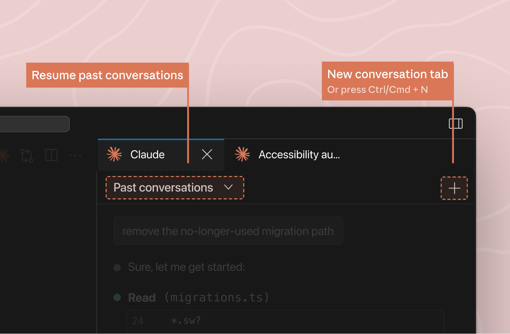

**Access your chat history and start new conversations anytime.**

Your conversations are saved automatically. Click the **Session history** button at the top or type **/resume** to browse past sessions and pick up where you left off.

To start fresh, click the **New session** button. You can also enable the **Ctrl+N** / **Cmd+N** shortcut in settings (`claudeCode.enableNewConversationShortcut`).
